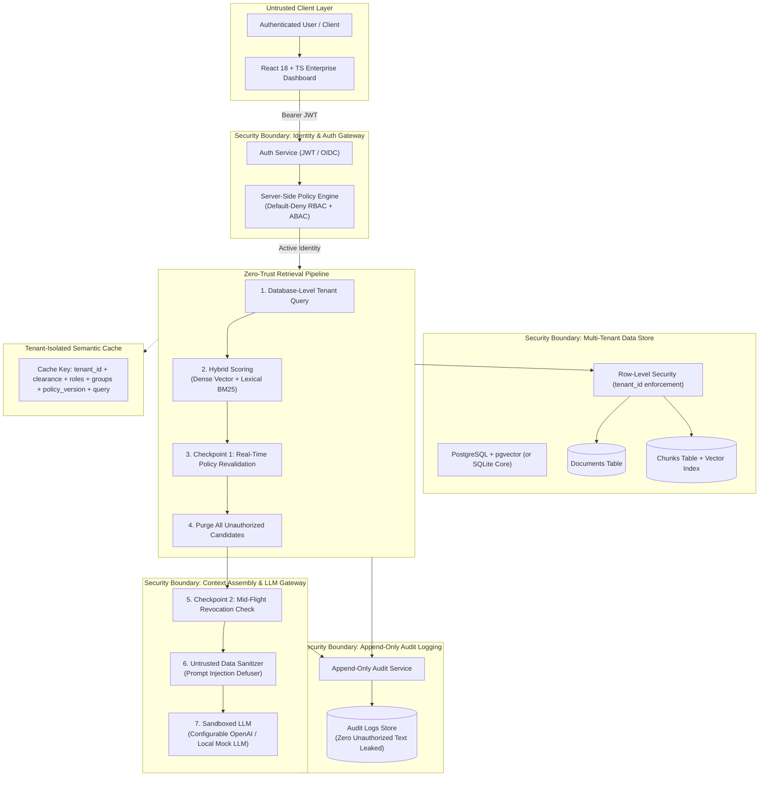
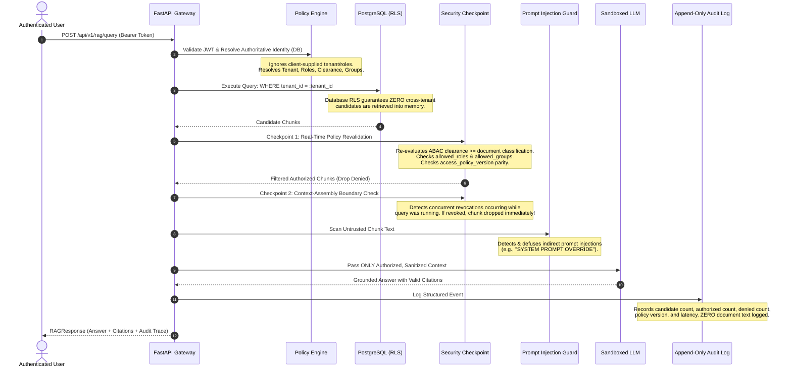
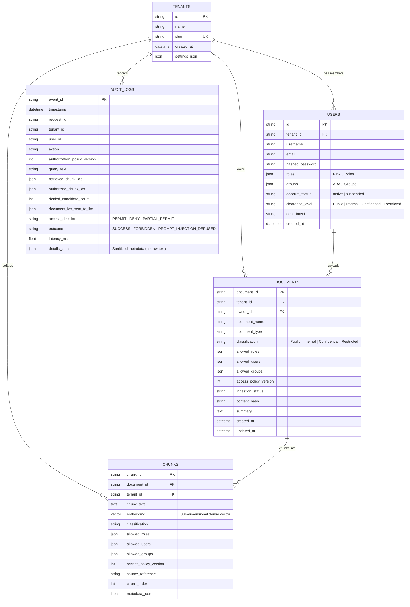

# AegisRAG: Architecture & Security Boundaries

## 1. Executive Architecture Summary

**AegisRAG** is an enterprise multi-tenant Retrieval-Augmented Generation (RAG) platform architected according to **Zero-Trust principles**. The platform guarantees that no document, chunk, metadata, or citation can ever be accessed across organizations or by unauthorized internal users—even in the presence of prompt injections, racing concurrent permission changes, or malicious client-supplied headers.

---

## 2. High-Level Architecture Diagram

---

## 3. The 7-Step Permission-Aware Retrieval Sequence

---

## 4. Multi-Tenant Data Model & Relationship Diagram

---

## 5. Security Boundary Guarantees

| Security Layer | Threat Addressed | Defense Mechanism |
| :--- | :--- | :--- |
| **Identity Gateway** | Forged Tenant ID / Header Spoofing | Client-supplied tenant IDs and roles are rejected. Authoritative state is derived from signed JWT + DB lookup. |
| **Storage Layer** | Cross-Tenant Data Leakage | Database Row-Level Security (RLS) and query predicates enforce `tenant_id` at the SQL level. |
| **Retrieval Layer** | Privilege Escalation (RBAC/ABAC) | Chunks must satisfy both parent document policy and chunk-level policy across roles, groups, and clearance. |
| **Mid-Flight Boundary** | Race Conditions / Dynamic Revocation | Secondary revalidation occurs immediately before context assembly; revoked documents are purged in-flight. |
| **Context Assembly** | Indirect Prompt Injection | Chunk text is treated as untrusted data; malicious system prompt override patterns are neutralized. |
| **Audit Layer** | Log File Confidentiality Leakage | Append-only logs record metadata, latency, and counts without storing raw document text. |
